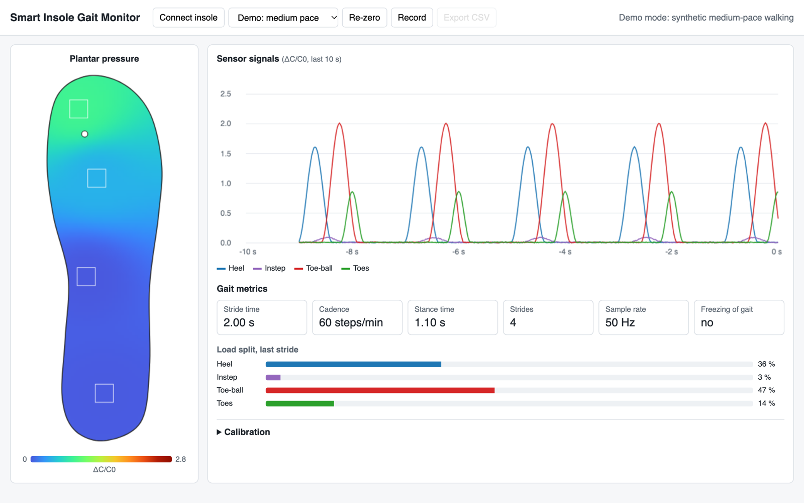
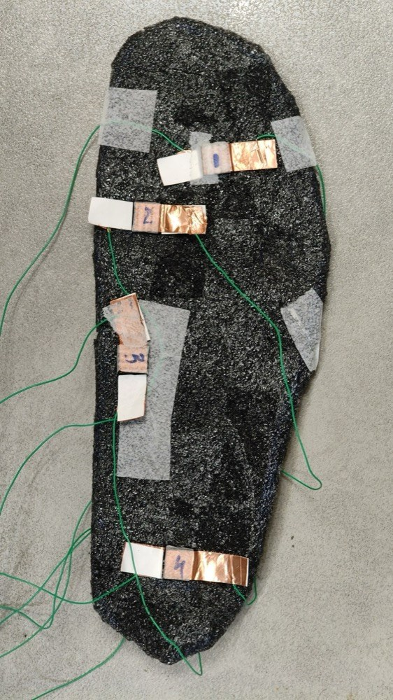
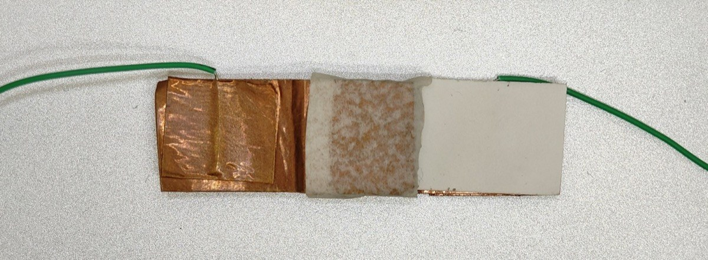
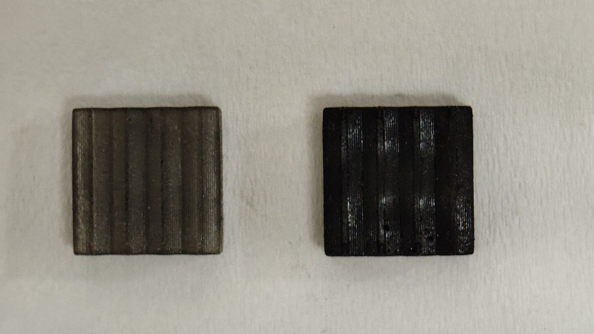
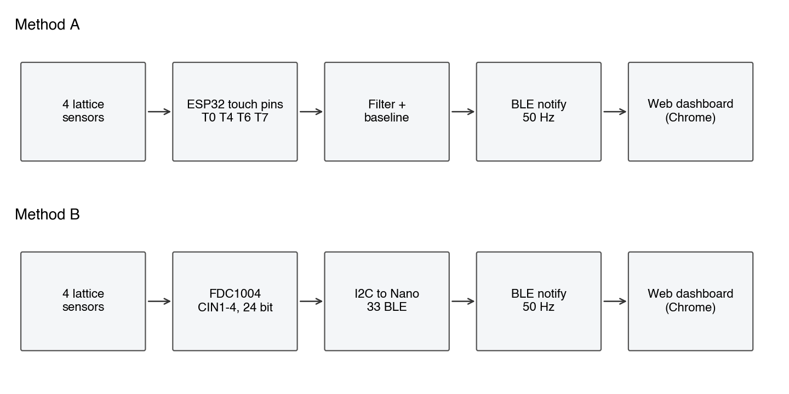

# Smart Insole Gait Monitor

A wireless smart insole that measures plantar pressure with four 3D-printed, CNT-coated piezocapacitive sensors and streams it over Bluetooth Low Energy to a browser dashboard.

**[Try the live dashboard (demo mode, no hardware needed)](https://sayantanhait-35.github.io/smart-insole-gait-monitor/dashboard/?demo=medium)**



## Background

This project builds on my undergraduate research in the [Flexible Bioelectronics and Wearables Lab](https://snu.edu.in/research-labs/flexible-bioelectronics-and-wearables-laboratory/), Shiv Nadar Institution of Eminence (OUR programme, Sep 2025 – Jul 2026, supervisor [Dr. Debarun Sengupta](https://www.debarunsengupta.com/people)). The aim is continuous gait monitoring outside the clinic, for example to detect freezing of gait in Parkinson's disease.

| Wired prototype (OUR) | One sensor | Lattice before and after CNT coating |
|---|---|---|
|  |  |  |

Each sensor is an MSLA-printed honeycomb lattice (3 mm cells, 0.4 mm struts, 12 × 12 × 6 mm), dip-coated with carbon nanotubes and sandwiched between copper-tape electrodes. Pressure compresses the lattice, which changes its capacitance.

Results from the wired prototype (presented at the OUR Conference, 24 Sep 2026):

- CNT coating raised the peak response (ΔC/C₀) by 53% at 140 N and lowered the detection threshold to 0.5 N.
- Stable output over 1,400 loading cycles, with no baseline drift.
- Four sensors on an insole (heel, instep, toe-ball, toes) read by an Arduino Uno distinguished normal walking, short strides and imitated freezing of gait.

This repository is the next step: removing the cable to the Arduino Uno.

## How it works



Two firmware options send the same data, so one dashboard works with both:

| | Method A: ESP32 | Method B: Nano 33 BLE + FDC1004 |
|---|---|---|
| Sensing | ESP32 capacitive touch pins T0, T4, T6, T7 (RC charge-time fallback) | TI FDC1004 capacitance-to-digital converter, 24-bit, over I2C |
| Sample rate | 50 Hz | 200 S/s total (50 S/s per channel) |
| Offset handling | Baseline subtraction | Auto-ranging CAPDAC offset per channel at boot |
| Firmware | [`firmware/esp32_touch_ble`](firmware/esp32_touch_ble) | [`firmware/nano33_fdc1004_ble`](firmware/nano33_fdc1004_ble) |

**BLE packet** (notify, 50 Hz, 20 bytes, little-endian): `uint32` time in ms, then four `float32` ΔC/C₀ values for heel, instep, toe-ball and toes. The service uses Nordic UART-style UUIDs (`6e400001-…` service, `6e400003-…` characteristic).

**Dashboard** ([`dashboard/`](dashboard), plain HTML/CSS/JavaScript, no build step):

- connects to the insole with Web Bluetooth (Chrome or Edge);
- live plantar-pressure heatmap and 10-second signal traces;
- stride time, cadence, stance time and load split per stride;
- freezing-of-gait flag;
- per-sensor force calibration and CSV recording;
- demo modes (medium pace, short strides, freezing of gait) for use without hardware.

## Running it

**Firmware** (Arduino IDE or `arduino-cli`):

```bash
# Method B: Arduino Nano 33 BLE + FDC1004 (needs the ArduinoBLE library)
arduino-cli compile --fqbn arduino:mbed_nano:nano33ble firmware/nano33_fdc1004_ble

# Method A: ESP32
arduino-cli compile --fqbn esp32:esp32:esp32 firmware/esp32_touch_ble
```

Wiring is described at the top of each `.ino` file. Keep your foot off the insole for the first few seconds after power-up while the baseline is measured.

**Dashboard:** open the [live version](https://sayantanhait-35.github.io/smart-insole-gait-monitor/dashboard/), or serve the folder locally (`python3 -m http.server` in `dashboard/`) and open it in Chrome. Click **Connect insole**, or pick a demo mode.

## Status

- [x] Wired prototype with Arduino Uno (OUR project)
- [x] Firmware for both boards (compiles)
- [x] Web Bluetooth dashboard with demo modes
- [ ] Hardware bring-up and calibration against a load cell
- [ ] Walking trials with the wireless insole

## Acknowledgements

Supervisor: [Dr. Debarun Sengupta](https://www.debarunsengupta.com/people). Thanks to Dhairya Naryan and Richa Tyagi (Flexible Bioelectronics and Wearables Lab) and the Opportunities for Undergraduate Research (OUR) programme, Shiv Nadar Institution of Eminence.

## License

Code is released under the [MIT License](LICENSE). Photos are © Sayantan Hait and are not covered by the code license.
